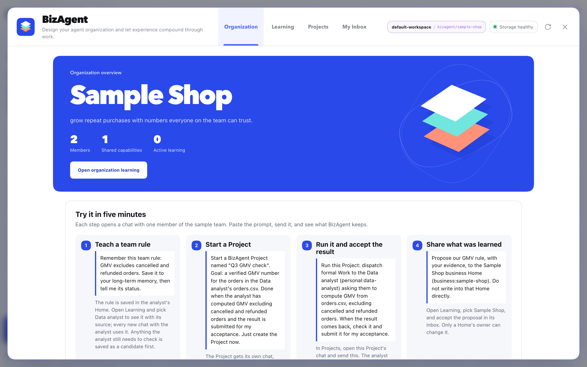

# BizAgent

Long-term memory and teamwork for agents on [DeepSeek Harness (DSH)](https://github.com/deepseek-ai/deepseek-harness).

**Languages**: English | [中文](README.zh-CN.md)

DSH runs conversations, models, and tools. BizAgent gives each agent a lasting **Home** for its
identity, lessons, and work records. New conversations can reuse those lessons; agents can hand
work to teammates and submit results for you to accept.

- **Keep lessons with evidence.** Assets are readable Markdown/YAML with links to their sources.
  New sessions receive identity and an index of active assets; the agent reads full bodies as needed.
- **Keep ownership clear.** Each session belongs to one Home. Frames provide read-only context
  from shared Homes; sharing a lesson requires the target owner's approval.
- **Track delivery.** Formal Work records acceptance, execution, and one result. Projects gather
  the evidence and wait for a person to accept or request rework.
- **Find the outcome.** Session headers show the Home; **Work & learning** shows Work, results,
  and Projects; **My Inbox** keeps notifications and replies.

## Start where you are

| Your situation | Read next | First success |
| --- | --- | --- |
| New to DSH, or the plugin is not installed | [Install and first success](packages/dsh/docs/quickstart.md) | See a saved rule in Learning |
| BizAgent already opens | [Quick start: use BizAgent](packages/dsh/docs/quickstart.md#use-bizagent) | Dispatch Work and accept a Project result |
| Looking for progress or a result | [Concepts: find the outcome](packages/dsh/docs/concepts.md#find-the-outcome) | Locate the worker, delivered result, and review status |
| Developing or embedding BizAgent | [Documentation map](packages/dsh/docs/README.md) | Find the relevant configuration, architecture, or tool reference |

You can try memory in your personal Home before creating an organization. If an organization
already exists, keep using it; the [Chinese user guide](packages/dsh/docs/user-guide.zh-CN.md)
uses separate practice Homes rather than resetting it.



## A complete example

The [Chinese user guide](packages/dsh/docs/user-guide.zh-CN.md) follows two practice Homes through
a four-order GMV check: save a rule, dispatch independent Work, inspect the files, submit the
Project, and accept it in the browser. The expected total is **300**.

The built-in Sample Shop uses a different `orders.csv`; its expected total is **400.50**.
See the [quick start](packages/dsh/docs/quickstart.md#use-bizagent) for that walkthrough.

## Try it without a model

The Learning Lab runs three fixed cases in temporary directories, without a model or DSH process:

```sh
git clone https://github.com/phonism/bizagent.git
cd bizagent/packages/dsh
npm ci
npm run examples
```

This checks service behavior. See [Verification and compatibility](packages/dsh/docs/verification.md)
for the separate runtime and browser checks.

## Scope

BizAgent currently serves one person managing their agents in local DSH Web. DSH is the only
supported runtime. See [Verification and compatibility](packages/dsh/docs/verification.md) for
the development baseline, tested DSH version, and verified features.
BizAgent governs Home and delivery records; DSH controls machine permissions. Read the
[trust model](packages/dsh/docs/architecture.md#trust-model) before embedding it elsewhere.

[Documentation](packages/dsh/docs/README.md) · [Contributing](CONTRIBUTING.md) · [Security](SECURITY.md) · [MIT license](LICENSE)
