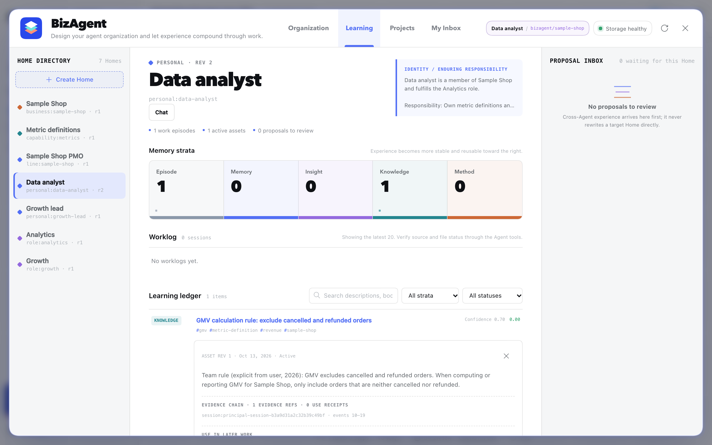
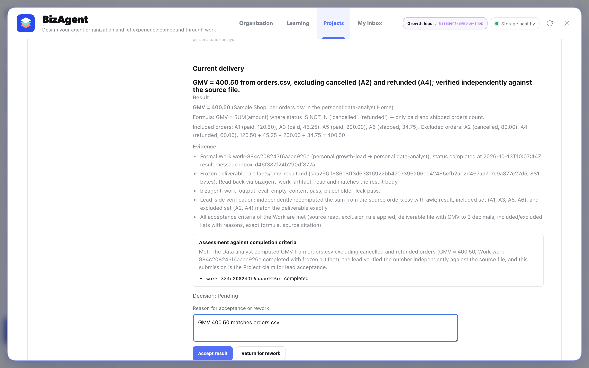
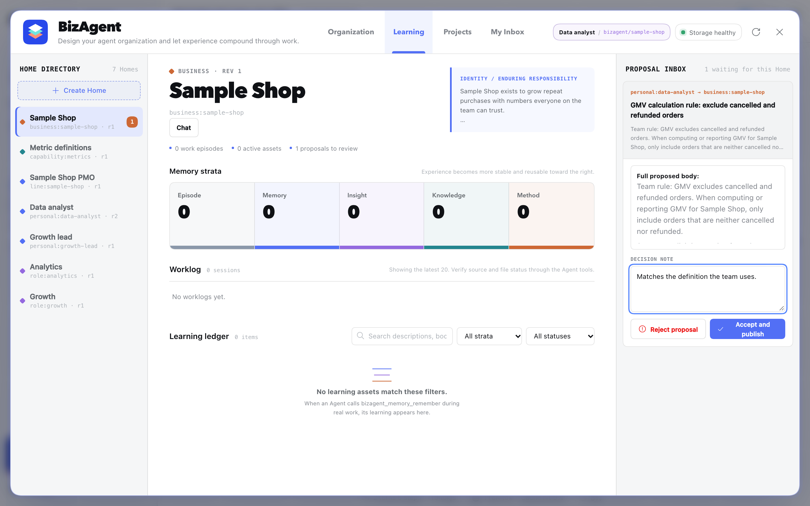

# BizAgent

给 [DeepSeek Harness（DSH）](https://github.com/deepseek-ai/deepseek-harness) 上的 Agent 加上长期记忆和团队协作。

**语言**：[English](./README.md) | [中文](./README.zh-CN.md)

BizAgent 是一个 DSH 插件。DSH 负责运行 Agent；BizAgent 给每个长期 Agent 一个"Home"，它不随某一次对话结束而消失，
并让几个 Agent 组成的小团队一起学习、一起干活：

- **Home。** 每个 Agent 的身份、记忆、知识和做事方法都放在它的 Home 里，是可以直接打开看的 Markdown 和 YAML 文件。
  每次和这个 Agent 开新对话，都从它 Home 里已有的东西开始。
- **带来源的经验。** 你纠正 Agent 或者教它一条规则时，它会把这条经验存下来，并记住是从哪段对话来的。
  它自己还不确定的内容会先标成"候选"，核实后才生效。
- **经过同意的分享。** 一个 Agent 可以把经验提议给另一个 Agent 的 Home，但只有那个 Home 的主人能接受。
- **Agent 之间协作。** Agent 之间可以发信、派正式工作（只有一份要负责的结果），也可以一起跑项目，最后由人来验收。


## 快速开始

需要 Node.js 22.19 以上或 24 以上、[pnpm](https://pnpm.io)，以及一个模型：DeepSeek API Key，或任意兼容 OpenAI 接口的模型服务。

```sh
npm install --global @deepseek-ai/dsh@0.2.0-rc.2 pnpm

git clone https://github.com/phonism/bizagent.git
cd bizagent/packages/dsh
npm ci && npm run build && npm pack
dsh plugin --profile web add "$PWD"/bizagent-dsh-*.tgz

export DEEPSEEK_API_KEY=sk-...   # 也可以在 DSH 的设置里添加别的模型
dsh --profile web
```

DSH 会打开浏览器。点左下角的 **BizAgent organization**，再点 **Create sample team（创建示例团队）**。
示例团队自带一份小订单表和 5 分钟上手指南：教分析师一条规则、发起一个项目、让分析师在自己的会话里干活、
验收结果、再把规则分享给团队。

换用其他模型、建自己的组织、常见问题，见[快速上手](./packages/dsh/docs/quickstart.md)（英文）。

## 示例团队，一步一步

下面的截图来自用开源模型（Qwen3.8 27B）实际跑一遍上手指南。界面语言跟随浏览器，截图是英文界面。

**1. 教一条规则。** 告诉数据分析师"GMV 不算已取消和已退款的订单"。它把规则存进自己的 Home，记下来自哪段对话；
以后和分析师的每段新对话都会带上这条规则。



**2–3. 跑一个项目，再验收结果。** 增长负责人发起项目。项目对话把正式工作派给分析师，分析师在自己的会话里用
`orders.csv` 算出 GMV；负责人复核后提交。只有你能点验收。



**4. 分享给团队。** 分析师把规则提议给示例商店的 Home。在 Home 的主人接受之前，那边什么都不会变。



## 不用模型先试试

Learning Lab 用真实的 BizAgent 服务跑三个写好的案例，数据放在临时目录，不需要模型，也不用启动 DSH：

```sh
cd packages/dsh
npm ci
npm run examples
```

## 文档（英文）

- [快速上手](./packages/dsh/docs/quickstart.md)
- [核心概念](./packages/dsh/docs/concepts.md)：Home、记忆、提议、信箱、正式工作、项目
- [配置](./packages/dsh/docs/configuration.md)
- [架构与信任边界](./packages/dsh/docs/architecture.md)
- [Agent 工具](./packages/dsh/docs/tools.md)（由代码自动生成）
- [Learning Lab](./packages/dsh/examples/README.md)
- [更新记录](./packages/dsh/CHANGELOG.md)

## 状态

BizAgent 1.0 对应 DSH `0.2.0-rc.2`，也就是 DSH 当前的发布版本（DSH 还没有正式版）。按本机单人使用设计：一个人拥有这个组织，并在 DSH 网页里验收结果。
版本号遵循语义化版本：1.x 之内，对外接口（`@bizagent/dsh` 和 `@bizagent/dsh/host`）、Agent 工具名和 BizAgent 写下的文件格式都不会做不兼容的改动。

这个仓库早期还包含一个 Claude Code / Agent SDK 的运行时，现在不在这里维护了；DSH 是唯一支持的运行环境。

## 参与贡献

见 [CONTRIBUTING.md](./CONTRIBUTING.md)。安全问题请按 [SECURITY.md](./SECURITY.md) 报告。

## 许可证

[MIT](./LICENSE)
