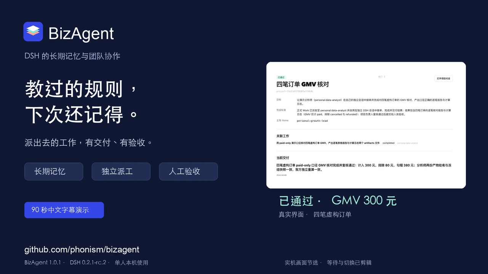

# 90 秒演示

[观看 / 下载 MP4](bizagent-demo.zh-CN.mp4) · [中文字幕 SRT](bizagent-demo.zh-CN.srt)

演示来自独立本机 DSH 环境中的实际操作和真实模型调用。视频采用关键界面画面节选、局部放大和中文字幕，
等待与切换已经剪辑；90 秒是成片长度，不代表任务实际耗时。字幕版无配音。

| 时间 | 内容 |
| --- | --- |
| 00:00–00:10 | 演示团队与各自的 Home |
| 00:10–00:24 | 保存 GMV 规则，查看正文、来源和生效状态 |
| 00:24–00:33 | 新项目会话按生效资产索引读取同一条规则 |
| 00:33–00:57 | 正式派工，查看分析师的独立执行会话和交付记录 |
| 00:57–01:06 | 查看逐笔核对结果：GMV 300 元 |
| 01:06–01:22 | 填写验收理由，项目在页面验收通过 |
| 01:22–01:30 | 插件安装与仓库入口 |

录制环境：`@bizagent/dsh-plugin` 1.0.1、DSH `0.2.1-rc.2`、DeepSeek-V4.1-Flash。
所有订单均为虚构：A paid 100、B paid 200、C cancelled 50、D refunded 30。
本例口径只计 paid，结果为 **300 元**，排除金额为 **80 元**。
Work 实际完成，Project 实际验收通过，提交文件与冻结快照一致。

按[用户指南](../../packages/dsh/docs/user-guide.zh-CN.md#完成一次协作练习)可复现同一业务流程；
视频中的团队名称和 Home 编号仅用于演示。功能支持范围见[兼容与验证](../../packages/dsh/docs/verification.md)。
