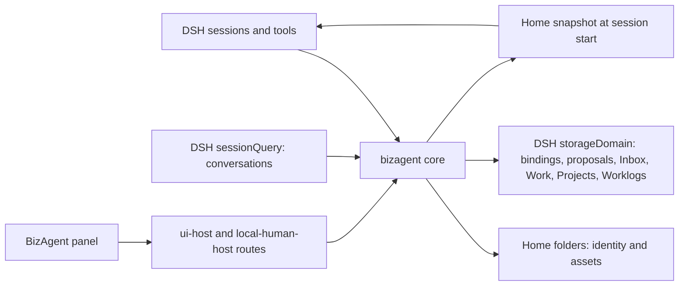

# Architecture and trust model

BizAgent is a set of DSH plugins. It does not run its own agent loop, server, or database: DSH runs
every session, calls the model, executes tools, and stores conversations; BizAgent adds Homes,
learning, and the records that connect agents.

## Components

| Plugin row | Module | Does |
| --- | --- | --- |
| `bizagent` | `@bizagent/dsh-plugin` | The core: binds sessions to Homes, adds the system prompt section, the Home snapshot, and the Agent tools, and runs Work, Inbox wake-ups, and learning reviews. |
| `bizagent-ui` | `@bizagent/dsh-plugin/ui-host` | HTTP routes for the BizAgent panel. |
| `bizagent-local-human` | `@bizagent/dsh-plugin/local-human-host` | Review routes for the local owner: Project acceptance, proposal decisions, My Inbox. |
| (browser) | `@bizagent/dsh-plugin/client` | Native organization panel, Session Home actions, Work & learning view, sidebar decorations, turn receipts, `@` references, and the Frame bar. |

The core needs these DSH services: `agents`, `tools`, `systemPrompt`, `storageDomain`,
`sessionQuery`, and `agentDefaultModel`. See [Verification](verification.md) for the development
baseline and separately tested DSH Web runtime.

## Where data lives

| Data | Stored in | Notes |
| --- | --- | --- |
| Homes: identity, assets, revisions | Home folders, as Markdown and YAML | Organization Homes inside `~/BizAgent/orgs/<id>/`, personal Homes in `~/BizAgent` (`homeRoot`). Written atomically; one bad file isolates its Home instead of stopping startup. |
| Organization structure | `organization.yaml`, `directory.yaml` | `directory.yaml` records each Home's owner, so editing `home.yaml` cannot change ownership. |
| Which organization is active | `homeRoot` | `active-organization.yaml`, naming the organization folder. |
| Session bindings, Frames, proposals, receipts, Inbox, learning reviews | DSH `storageDomain`, domain `bizagent` | Versioned records validated on read. |
| Formal Work, Projects, Worklogs | DSH `storageDomain`, their own domains | Frozen copies of their files are kept in the data folder of the Home they belong to: the organization folder, or `homeRoot` for personal Homes. |
| Conversations | DSH sessions | Assets point at session events as evidence. |

Only one DSH process may run BizAgent against the same data: startup takes a writer lock on
`$DSH_HOME`, `homeRoot`, and the organization folder, and a second process skips BizAgent with
"BizAgent writer is already reserved". A lock left by a crashed process is recovered on the next
start.

Backups need both halves: the Home folders (`bizagent archive export`, which records a digest of
every file) and DSH's own data directory.

## A session, step by step

1. DSH creates or resumes a session. BizAgent resolves its Home from the working directory and
   records the binding once.
2. BizAgent adds a Home snapshot (identity plus the index of active assets) and, if mail is
   waiting, an Inbox digest. Both are skipped when the session already holds the current version.
   A failure here never blocks the session; it is reported in the panel's health status.
3. At DSH's `agent/pre-step` boundary, selected `@Agent` references are revalidated and resolved
   into logged, bounded Home snapshots before the model request. Transport markers are removed
   from the admitted user text. A failed load produces an explicit notice. A retry loads a full
   snapshot again so cancelled admission cannot leave the model relying on an unlogged copy.
4. The agent works. BizAgent tools read and write only the bound Home, except through proposals,
   Inbox messages, Work, and Projects.
5. At the end of a turn with an explicit correction, BizAgent asks the agent once to decide
   whether to keep it.
6. When the turn is saved, BizAgent records a Worklog for turns that used tools.

## Native DSH surfaces

The organization workbench occupies DSH's keyed `main` panel and has a `sidebar.panellist`
entry. It shares navigation with the host instead of covering it with an application-wide modal.
The current Session remains available when returning to the conversation.

Session headers expose the bound Home, candidate/proposal counts, and My Inbox. The
`conversation.view` entry **Work & learning** shows Work directly dispatched from or assigned to
this exact Session, related Projects, and successful BizAgent tool results. Sidebar row decorations,
hover details, and a context-menu action identify Principals, Project Mains, workers, Inbox wakes,
and learning reviews. `conversation.chat.turnTail` shows receipts from the original completed turn.
An unfinished or failed tool call cannot produce a success receipt. Historical receipt status is
labelled separately from the current Work record. Runtime status is read from live DSH Agents;
an accepted Work does not imply a running worker.

Authenticated `/api/bizagent/v1/sessions` supplies a lightweight catalog without opening Session
logs or creating bindings. `/api/bizagent/v1/session-context` resolves one existing Session using
the same live/persisted lookup and trust checks as the Frame API. Browser readers share requests,
abort abandoned loads, stop polling when unobserved, and pause polling in hidden tabs. The Work
view shows the latest 20 Work records and the latest 100 successful activity records.

Sessions that BizAgent starts itself (Work workers, Inbox wake-ups, learning reviews, Principals,
Project Mains) join DSH's default agent preset, so they have the same built-in tools as sessions
you open, and use the host's current default model.

Opening a worker from the Work view uses the authenticated agent-session route to reveal an
already bound, locally owned Session in its Home Workspace. It does not recreate or start its
Agent, and ordinary conversations keep their existing Workspace. For the user path, see the
[quick start](quickstart.md#use-bizagent) or [Chinese user guide](user-guide.zh-CN.md).

## Trust model

BizAgent is built for **one person on one machine**. It keeps agents honest about whose Home they
write to; it is not a sandbox.

What BizAgent enforces:

- **Tools act as the session's Home.** No tool writes another Home's assets, and an agent cannot
  accept a proposal, review shared Knowledge, or accept a Project result.
- **People decide in the browser.** Acceptance and review routes require DSH's own web login
  (the cookie DSH issues from the URL it prints), or a Bearer token from a private file that
  scripts can use. Every BizAgent route also checks that the request comes from the loopback
  address and the same origin, which blocks other websites and DNS rebinding.
- **The BizAgent API needs the DSH login too.** Other local programs cannot list or change Homes
  through it without the login cookie.
- **Other Homes' text is fenced.** Messages, proposals, and Frame content from other Homes reach
  the model marked as untrusted data, not instructions.
- **Work and wake-ups start only between Homes with the same owner.** Work for someone else's Home
  waits until that Home picks it up itself.

What it does not do:

- **Agents can reach the files.** A Home's folder is also its working directory, and DSH agents
  have shell and file tools. An agent can read or edit its own Home files directly, read other
  folders your user can read, and could find a token file. BizAgent's rules rely on the agent
  using BizAgent's tools. Ownership is checked against `directory.yaml`, and `bizagent doctor`
  reports Home files that no longer load or no longer match their recorded owner.
- **No multiple users.** Everyone signed in to DSH acts as the owner. Hosts that need accounts
  should mount the routes from `@bizagent/dsh-plugin/host` behind their own login.
- **No sandbox.** Use DSH's permission modes and sandbox settings to limit what agents may do on
  your machine.

## Compatibility

`@bizagent/dsh-plugin` declares its DSH packages as peer dependencies at `^0.2.1-rc.2`; its development
dependencies, installation guide, and runtime CI pin `0.2.1-rc.2`, also used for manual Web
acceptance. See [Verification](verification.md). DSH validates activation compatibility at startup.
BizAgent records
`schemaVersion` on every stored record and refuses records it does not understand rather than
guessing.

## Source map

| File | Responsibility |
| --- | --- |
| [index.ts](../src/index.ts) | Plugin entry: wiring, DSH event hooks, system prompt section |
| [service.ts](../src/service.ts) | BizAgent operations behind the tools and routes |
| [home-store.ts](../src/home-store.ts) | Home folders, organizations, assets, doctor checks |
| [ledger.ts](../src/ledger.ts), [work-ledger.ts](../src/work-ledger.ts), [project-ledger.ts](../src/project-ledger.ts), [worklog-ledger.ts](../src/worklog-ledger.ts) | Records in DSH storage |
| [tools.ts](../src/tools.ts) | Agent tool definitions |
| [agent-preset.ts](../src/agent-preset.ts) | Sessions BizAgent starts join a preset and get a model |
| [work-runner.ts](../src/work-runner.ts), [inbox-wake-runner.ts](../src/inbox-wake-runner.ts), [learning-session-runner.ts](../src/learning-session-runner.ts) | Sessions started for Work, mail, and learning reviews |
| [ui-host.ts](../src/ui-host.ts), [local-human-host.ts](../src/local-human-host.ts) | HTTP routes for the panel and local reviews |
| [route-guard.ts](../src/route-guard.ts) | Loopback, origin, and DSH login checks for every route |
| [client/](../src/client/) | Browser panel |
| [session-surface.ts](../src/session-surface.ts) | Session catalog, current Work and Project summaries, durable tool-result receipts |
| [frame-admission.ts](../src/frame-admission.ts) | Selected Home snapshots at the DSH step admission boundary |
