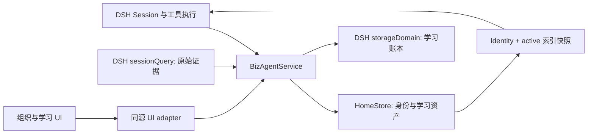

# DSH 架构与责任边界

本文描述当前源码。安装步骤见[快速上手](quickstart.md)，状态转换见[学习生命周期](learning-lifecycle.md)。

## 一次工作如何成为下一次工作的上下文

DSH 执行任务并保存会话事件。BizAgent 为 Session 确定长期 Home，注入有预算限制的身份与资产索引；
Agent 在需要时读正文，把值得复用的经验写回 Home，并通过后续使用结果修订它。



BizAgent 复用 DSH 的 Agent Loop、模型调用、工具执行、Session、存储设施和 Web 宿主。插件不负责训练模型，
也不会因创建了组织成员就自动启动一组 Agent 或安排任务。

## 四种 Home 是所有权边界

Home 地址形式是 `<type>:<id>`，例如 `role:growth-strategy`。目录名由存储层生成，调用方应使用地址，
不要根据地址自行拼接物理路径。

| 类型 | 适合承载 | 示例 | 如何决定归属 |
| --- | --- | --- | --- |
| Personal | 某位长期 Agent 的习惯、观察与工作经验 | `personal:analyst` | 是否只适用于这个责任主体？ |
| Business | 业务共同定义、范围和规则 | `business:demo-store` | 是否应由业务整体维护？ |
| Role | 可随岗位交接的职责与方法 | `role:growth-strategy` | 换人接手后是否仍然适用？ |
| Capability | 多成员复用的专门能力 | `capability:config-review` | 是否可被多个岗位重复使用？ |

Organization 是这些 Home 的关系清单，不是第五类 Home。它记录 Business 根、Personal/Role 配对、
Capability，以及 `member-of`、`fulfills-role`、`serves` 关系。关系本身不授予跨 Home 读写权限。

显式 `bizagent_frame_open` 在同一本地 Home root 中读取 active 的 Business、Role 或 Capability Home，提供只读
Identity 与 active 索引；随后 `frame_search/read` 才能查其正文。Personal Home 在跨 Home 情况下拒绝读取。
`bizagent_agent_search` 在当前 Session 的组织范围内检索这些共享 Home 和主 Personal Home 的规范地址与显示名；
Frame 可用唯一显示名打开，同名时必须指定规范地址。此目录不等于跨用户授权。
`lead/contribute/reference` 是该 Session 的参与标记；每次打开都会把对应的主导、协作或参考指令交给模型，
包括未变化的重复打开和 mode 切换。目标 Home 的 Identity 与资产仍是低信任资料，不能覆盖用户意图、宿主策略、
工具权限或 Memory 写入 owner；mode 也不切换 DSH Agent 身份。
最多同时打开 8 个 Frame，最近打开者是默认检索 focus。打开、关闭、参与状态和 context epoch 保存在 DSH 学习账本；
首次打开、Home 修订变化、成功的 DSH 压缩后首次重新打开或显式刷新会在工具结果中返回完整 Frame 上下文；
未变化的重复打开返回轻量回执。Frame 状态会报告需要刷新的地址，压缩失败不会触发刷新。
关闭不会擦除历史工具结果。DSH 输入触发源可从当前 Session 可见的共享 Home 中选择 `@Agent`，
发送时重查目标并在模型文本中请求显式 `bizagent_frame_open`；选择本身不读取 Home，也不证明模型已执行工具。
对话输入框上方的只读上下文栏按当前 Session 显示主 Home、已打开 Frame 的模式、focus 与待刷新状态，
并明确说明 Frame 不代表独立 Agent 执行。状态由宿主读取实际 Session 与 Frame 账本后返回。
当前本地 UI Host 无多用户身份边界。此版本还没有真正的动态 responder/tool scope。

跨 Home 的普通异步通信使用独立 Inbox 消息。发件 Home 和 return-to Session 从当前 DSH binding 导出；
不可变正文、收件地址、回复线程与逐收件人投递状态保存在学习账本 metadata。收件方只能读和处理投递给
自己的信，发件方可以查看其投递结果。新启动的已绑定 Session 会注入待处理信头摘要，不注入正文。
指定 Project ID 的普通通信会验证 lead 或活跃 Seat 资格，将已加入的目标 Home 解析为项目 Seat 地址；
消息、投递回执、唤醒计划和回信路由保留 Seat 地址，执行 Session 仍绑定席位对应的 Home Workspace。Seat 唤醒 Session 的提示
从当前 Project 修订注入项目目标、完成标准、Seat 职责及 Home 边界；地址不改变工具权限。
回复继承项目上下文并保留原发件地址；释放后的 Seat Home 可读历史投递，不能发新的项目信，
未启动的席位唤醒会跳过。旧 Home 地址信仍沿旧地址回复。
普通信另保存话题 ID 与机器接力深度；可信宿主可以把唤醒来源冻结到收件 Session，后续发信即使不带
`reply_to` 也继承同一话题的 6 跳与 12 封限制。唤醒来源的 Session 不可改绑到另一话题。
结论信核验 `context_refs` 中至少一个位于发送 Session Workspace 内的真实文件，并记录通过核验的相对路径；
它继承话题，允许在普通信上限之后写入，关闭话题且不安排唤醒。唤醒与催办扫描跳过已关闭话题，
已冻结但未启动的计划在执行前也重新检查关闭状态。文件指针不冻结文件内容。
`user:<id>` 是独立的真人收件地址，不能映射成 Personal Home。升级信要求主送真人、期限与行动说明，
并关闭机器话题；真人信件与处理回执保存在 Inbox 账本。核心包导出需宿主认证和写入校验的真人 HTTP 路由，
回信由认证用户身份产生新话题并主送原 Agent Home 或 Seat，return-to 恢复器优先投原 Session。
可选 `InboxStalledEscalationRunner` 扫描达到 6 跳或 12 封普通信上限、静置 24 小时且未关闭的话题；
宿主须返回已核验的执行责任人和持久授权引用，不能直接信任 Home `owner` 字符串。扫描后在 Inbox
写锁内复核终态，按话题幂等写入 `engine:inbox` 升级信，并保留参与 Agent 的回信地址和原 Session。
核心包不自带用户目录、登录、自动扫描定时器或实际渠道凭据；`delivered` 仍只表示持久入箱。
宿主可另接 `HumanNotificationRunner`：按消息和真人地址先冻结 `unknown` 发送意图，再调用渠道；
仅凭可核验回执转 `sent`，确定拒收转 `rejected`。未知结果和写回失败都不自动重发；确定拒收可显式
重试并留存前次原因。通知状态不覆盖站内投递或处理回执。
`delivered` 仅表示持久入箱。普通信的主收件人若有 Workspace 映射，且双方 Home 活跃、同属一个显式
owner，则可由 Inbox wake runner 创建独立 DSH Session：urgent 立即检查，normal 使用收件 Home 的
`inbox.json` 作息（immediate、batch、scheduled、carried，缺省 batch 15 分钟）。发信时将每位主收件人的
生效策略和唤醒时间冻结在投递回执上；后续配置变化不追改既有信。scheduled 使用上海时间五字段 cron，
`cc` 不唤醒。普通作息按收件 Home 与 owner 合并待处理信，紧急信与原 Session 不可用的回信兜底按话题唤醒。
每个持久计划冻结最多 20 封信、Workspace、Session ID 和最深的话题来源；
普通信冻结发信 Agent 可用的模型设置，唤醒器在创建或恢复 Session 时沿用；真人回信沿用原 Agent 信的设置。同一 Home 的上一批 Inbox
Session 空闲前不启动下一批。启动与每 30 秒扫描时每批最多尝试 4 个计划，失败后延迟重试。
新 Session 的自动摘要只列入本计划的待处理信。
普通回信若主送原发件 Home，则先检查原信的 return-to Session：核对持久 Home binding，向在线 Session
入队，或恢复持久 Session 后入队。稳定提示 ID 和逐信路由回执支持重启核对；确定无可用原 Session 才
记录 fallback，让普通唤醒器立即考虑新 Session，即使收件方通常采用 carried 作息。原路由未决或已入队的回信不另起收件 Session。
主送普通信可带 ISO `due`；到期仍未处理、无期限但入箱 24 小时未处理、或已入原 Session 两小时仍未处理，
每个收件回执只安排一次按话题催办。启动时与每 5 分钟扫描，先持久化独立唤醒计划，再记 `nudgedAt`；
回执写入失败可由已有计划恢复。`cc` 和正式 Work 消息不参加普通 Inbox 催办。
`followup` 入队和计划回执不证明 Agent 已处理信件；Inbox 不承担正式 Work 的状态或验收。

正式 Work 使用独立 `bizagent_work` domain，以请求 Home、执行 Home、目标、完成标准和幂等键固定责任。
创建时先写责任再投 Inbox 请求；有目标 Workspace 映射时先冻结自动启动意图，插件在请求送达后通过 DSH Agent 工厂创建或恢复独立 worker，
预先固定 Session ID、Home binding、工作目录和模型路由，并在会话开场后送入带 Work ID 的提示。插件持有
AgentHandle，完成后待空闲释放，卸载时也释放自身持有的句柄。没有映射时，目标 Home 可由已有 Session
显式认领。目标 Home 只能由一个明确的 DSH Session 独占认领；完成时先锁定唯一结果
正文与消息 ID，投递成功后标记 completed；取消适用于 open 或 accepted，取消通知也走 Inbox。
失败后用相同参数重试可补齐通知，并保留第一次预留的结果。worker 启动失败也保留固定 Session ID，
请求方可调用 `work_start` 重试；已持久化的 DSH Session 用 `agents.resume()` 恢复。插件启动时先按持久 Work
补投缺失的请求、结果和取消 Inbox 通知，再逐项恢复已预留 worker Session 和工作目录的未完成 Work，
最后启动冻结了自动启动意图且请求已送达的未预留 `open` Work；原 Session 与提示 ID 去重。
启动恢复两类 Work 共用每批 4 项的上限，后续每 30 秒再扫描；失败项延迟至少 5 分钟重试。
旧记录没有自动启动意图时不主动启动。
Work worker 的唤醒来源固定为请求消息 ID，因此它发出的普通 Inbox 信即使不带 `reply_to`，也继承这一话题预算。
完成 Work 时可从执行 Session 的绑定 Workspace 冻结 `artifacts/` 文件；路径、SHA-256 与长度先写入结果预留，
通知失败后沿原预留恢复。请求方与执行 Home 可回读精确快照；Project 接受时会重查引用 Work 的快照。
目前没有跨进程 CAS；认领 ID 不证明 Session 仍在执行，通知投递也不证明真实执行。

Project 另用 `bizagent_project` domain 保存 lead Home、目标、完成标准、关联 Work 的提交时状态快照，以及每版
结果声明和接受/返工记录。lead 可邀请活跃共享 Home 加入有稳定地址和责任说明的 Project Seat，变更与释放留在
Project 修订历史中；活跃 Seat Home 可读取 Project、关联 Work 与结果产物。邀请不产生正式 Work，Project 普通 Inbox
使用 Seat 地址，Work worker 仍按 Home 地址执行。
只有 lead Home 能关联 Work 或提交；Agent 只能退回当前结果主张，最终接受须经
宿主认证的真人审核。提交与新增 Work 在本进程的 Project 写队列中串行。提交时需有已投递的正式 Work
结果，或冻结在 Home 的本地文件产物；验收前核对文件快照。已接受不证明所有 DSH 进程已停止。
普通 Home Session 可显式记录当前 Project turn，手工 Work 认领和提交也会记录；后续无关轮次不受旧项目关联影响。
真人审核路由要求宿主接入身份与当前 Project 授权；默认本地 UI 不提供这种身份边界。Work 状态
不是实时进程证明。

## Session 与 Workspace 的关系

Workspace 提供工作目录；Home 提供长期学习的归属。多个 Session 可以使用同一 Home；一个已绑定的 Session
不会因为工作目录改变而切换 Home。UI 中点击某个 Home 只是在浏览其账本，不会重新绑定当前聊天 Session。

新 Session 的解析顺序如下：

1. 复用已存在的 Session binding；若它不属于当前组织，报告持久化问题，不静默改绑。
2. 对新 binding，匹配 `workspaceHomes` 中最具体的目录前缀。
3. 使用配置中存在于当前 HomeStore 的 `defaultHome`。
4. 若仍没有匹配，使用当前组织的 Business Home；没有组织则保持未绑定，学习工具会报告错误。

在 Web 引导中创建组织时，完整的 Home root 位于 `<DSH 工作区>/bizagent/<组织 ID>`。注册目录中的
`active-organization.yaml` 记录该位置。底层 CLI 与兼容接入仍可显式配置 `homeRoot`、`defaultHome` 和
`workspaceHomes`；这不是组织引导要求用户再做一次映射的步骤。

## 数据分别保存在哪里

| 数据 | 持久化位置 / 所有者 | 恢复时的作用 |
| --- | --- | --- |
| Organization、Home 目录与元数据 | 组织 Home root 下的 YAML | 恢复关系、地址、revision |
| Identity、Memory、Insight、Knowledge、Method | Home 内的 Markdown；资产带 YAML frontmatter | 恢复身份和长期内容 |
| Session binding、Frame 状态、Inbox 信与投递/处理回执、proposal、receipt、checkpoint | DSH `storageDomain` 的 `bizagent_learning` domain | 恢复绑定、协作消息、待审提案、使用记录与结算状态 |
| 正式 Work 的目标、完成标准、owner、结果预留与终态 | DSH `storageDomain` 的独立 `bizagent_work` domain | 恢复责任、唯一结果与取消；与 Inbox 投递状态分别核对 |
| Project 目标、完成标准、Work 关联、结果声明与审阅 | DSH `storageDomain` 的独立 `bizagent_project` domain | 恢复版本化提交与 lead Home 的接受或返工记录 |
| Worklog 修订、Session 指纹与文件哈希 | DSH `storageDomain` 的独立 `bizagent_worklog` domain | 恢复可搜索工作摘要，重读 DSH Session 和 Workspace 文件以核验来源 |
| Worklog 文件版本快照 | Home 根目录 `worklog-snapshots/sha256/` | 随 Home 归档保留原始字节，按 Home 权限回读，恢复包校验快照引用 |
| Project 结果文件快照 | Home 根目录 `project-snapshots/sha256/` | 冻结每版结果声明的本地文件字节，验收和恢复时核验 |
| 正式 Work 结果文件快照 | Home 根目录 `work-snapshots/sha256/` | 与唯一结果预留绑定，Project 验收和恢复时核验 |
| 主动事件与行动回执 | DSH `storageDomain` 的独立 `bizagent_proactive` domain | 恢复待处理信号、裁决和至多一次行动记录 |
| Pulse 指标、运行与数值 | DSH `storageDomain` 的独立 `bizagent_pulse` domain | 恢复指标版本和已完成取数 |
| 订阅提议、约定、每期 Work 与触发回执 | DSH `storageDomain` 的独立 `bizagent_subscription` domain | 恢复排程和冻结 Work；重启后核查中途启动的 Session |
| App、制品、Release、安装修订、Resource、Action 回执与写入计划 | DSH `storageDomain` 的独立 `bizagent_app` domain | 恢复不可变版本、安装指针和可核查的调用结果 |
| 远端任务、句柄、结果与通知 outbox | DSH `storageDomain` 的独立 `bizagent_remote_operation` domain | 恢复未知提交、继续查询旧句柄并按原事件 ID 通知 |
| 本地项目设备、挂载、Session 绑定、命令与文件版本 | DSH `storageDomain` 的独立 `bizagent_local_project` domain | 恢复待取命令、终止过期命令并校验文件版本水位 |
| 原始用户消息与工具事件 | DSH Session 存储，经 `sessionQuery` 回读 | 核验资产引用的证据 |
| 当前组织位置 | 配置注册目录的 `active-organization.yaml` | 启动时定位组织 Home root |
| 性能页采样历史 | UI Host 内存 | 仅供当前进程展示，重启后重新采样 |

因此，复制组织文件夹可以保留学习正文，但不足以完整恢复提案、绑定和原始证据。完整迁移需要同时保留相应
DSH profile 的存储与 Session 数据，并校验组织位置；当前没有一键迁移工具。具体存储备份方式取决于 DSH 宿主。
Home 文件层可用[版本化归档命令](home-archive.md)做 SHA-256 校验和空目录恢复；
逻辑状态恢复包进一步涵盖十三个 BizAgent 账本和已绑定 Session 的逻辑事件，
但仍不包含 Workspace、凭据或完整 DSH profile。

Home 结构示意：

```text
<organization-root>/
├── organization.yaml
├── directory.yaml
└── homes/
    └── <generated-home-directory>/
        ├── home.yaml
        ├── identity.md
        ├── memory/*.md
        ├── insights/*.md
        ├── knowledge/*.md
        └── methods/*.md
```

## 上下文与检索

`agent/session-start` 时，插件通过 `agent.inject()` 写入持久 Home Snapshot。快照带 Home 地址、revision、digest，
相同可见快照不会重复注入。Identity 与 active 索引各有 UTF-8 字节预算，默认分别为 6144 和 16384 字节；
这不是整个模型上下文的 token 上限。

索引只带资产 ID、类型、简述和标签。`memory_search` 在当前 Home 的 ID、标题、简述、标签和正文中做不区分
大小写的子串匹配，默认只查 active，最多返回 100 条。排序使用状态、类型、fitness、更新时间等字段，
不是语义相似度排序。命中之后必须 `memory_read` 才获得正文和 `sourceRefs`。

资产变化可影响后续 session-start 的快照；当前实现没有每次写入后向所有正在运行的 Session 广播新上下文。

`bizagent_episodes` 从持久 Session binding 列出当前 Home 的工作经历，`bizagent_episode_read` 再从 DSH
`sessionQuery` 分页回读原始事件。它们不复制 transcript，也不把历史事件自动判为有效经验；跨 Home Session
不可通过这些工具读取。可显式写入 Session Worklog；Episode 列表会附带最新摘要，`bizagent_worklogs` 在
当前 Home 搜索最新修订，`bizagent_worklog_read` 回读完整正文并核验 Session 指纹、所引文件的当前哈希与
保留快照。新修订的文件字节以 SHA-256 命名保存在 Home 根目录，`bizagent_worklog_file_read` 按范围读取；
旧修订没有快照时仍只提供哈希。Worklog 修订独立保存于 DSH domain，内容仍是工作记录，不自动成为知识。

增量学习扫描对每个旧 Session 计算事件内容指纹，在 DSH `bizagent_learning` 的 metadata 表记录扫描观察与
单独的显式审阅回执；追加事件会得到新指纹，旧回执不能覆盖新内容。扫描时不可读的 Session 不推进进度。
这提供可恢复的材料水位，尚无后台调度、模型做梦、实际文件差异或跨运行时迁移。
当前也没有专用学习执行模式，扫描可能在后续会话中再次看到先前的审阅会话；接入专用模式时需按持久执行标记
排除它，同时保留普通会话中真实新增的工作材料。

## 写入、一致性与边界

HomeStore 在单个实例内串行执行 mutation，文件使用临时写入与 rename。`expected_revision` 在串行区内检查，
避免两个编辑者用同一旧版本互相覆盖。DSH Domain 将表快照缓存在进程内，单次写入加锁不能让另一个进程刷新旧快照。
插件启动前会在明确的 `DSH_HOME`、配置的 Home root 和当前组织根目录各创建 `.bizagent-writer.lock`；
短暂的 `.bizagent-writer-claim.lock` 使并发启动者串行检查旧锁。同路径的活动写者使第二个进程拒绝启动；
正常卸载释放锁。同机旧锁的 PID 确认不存在时，下一次启动在领取闸门内回收旧锁。隔离 Web profile 冒烟检查验证了
第二个真实 DSH 进程被拒绝、正常退出和异常退出后同一 profile 均可重新启动。此守卫只覆盖都运行了当前版本插件且共享这些根目录的本机进程；
它不是跨主机租约，也不提供跨 domain 事务或 CAS。

两个文件都记录 PID、主机名与创建时间。跨主机、无法判定 PID 或锁内容损坏时守卫保持拒绝；
如果进程恰在领取闸门内异常退出，闸门文件也须人工核验原进程已退出且无并行启动，再删除**所报路径**并重启。
不要因启动超时就删除仍由活动进程持有的锁。

Home 文件与学习账本不是同一事务。宿主授权的真人接受提案时，先在 pending 提案冻结审核人、授权引用、动作、
理由和时间，再写目标资产，最后写 accepted 状态；启动时会检查已写入资产但尚未结算的 pending 提案，
按原审核记录恢复结算。相同裁决重试可返回已有资产；若 accepted 提案缺失对应资产，会记录异常。
这是一条有边界的恢复路径，不是所有操作都具备分布式事务或 exactly-once 保证。

Inbox 在本插件账本实例内串行写入：先写各收件地址的投递回执，再写消息，避免可见消息缺少投递结果；
同一发件 Home 与幂等 key 的重试核对内容。部分回执写入后失败可按相同 key 重试；当前没有跨进程
事务/CAS。普通 Inbox 用持久信件扫描补齐待唤醒计划与回信路由，用计划/路由回执和稳定提示 ID 恢复启动；
跨主机单写者租约、Agent 实际执行确认、更多收件策略与故障后的严格一次投递保证仍待实现。
Work 也只在单个插件实例内串行预留；跨 Work 域与 Inbox 域没有原子事务。请求写账后通知失败、结果
预留后通知失败，会保留可检查的状态并允许原操作重试；插件启动时根据 Work 的冻结正文与稳定消息 ID
补投缺失通知，并在结果送达后结算 `completing` Work。普通 Inbox 和其他跨域通知尚无统一补投日志。

Agent 写工具只操作当前 Home；显式 Frame 工具能只读其他共享 Home 的 active 内容。Agent 只能提交和读取
跨 Home 提案，不能接受或拒绝。默认本地 UI 不挂载裁决路由；宿主可显式挂载认证路由，以真人会话身份、
写入防护和逐提案权限回调裁决。核心服务信任该宿主授权回调，未自带用户目录或 RBAC；浏览器传入的
Home 地址不是用户凭证。
文件系统访问还应由宿主权限与 sandbox 限制。

## 代码地图

| 文件 | 读它可以回答什么 |
| --- | --- |
| [index.ts](../src/index.ts) | 插件依赖、Session snapshot、学习检查点如何接入 DSH？ |
| [domain.ts](../src/domain.ts) | Home、资产、证据和提案的数据结构是什么？ |
| [config.ts](../src/config.ts) | 配置如何归一化，目录如何匹配？ |
| [home-store.ts](../src/home-store.ts) | 文件怎样存储、检索、排序和更新版本？ |
| [ledger.ts](../src/ledger.ts) | 绑定、提案、回执和检查点怎样保存？ |
| [work-ledger.ts](../src/work-ledger.ts) | 正式 Work 的独立状态与唯一结果预留怎样保存？ |
| [project-ledger.ts](../src/project-ledger.ts) | Project 目标、声明和审阅怎样独立持久化？ |
| [work-runner.ts](../src/work-runner.ts) | DSH worker Session 怎样创建、恢复、去重和释放？ |
| [cron.ts](../src/cron.ts) | 上海时间五段 cron 怎样计算下一次触发？ |
| [service.ts](../src/service.ts) | 所有权、发布、裁决、证据与反馈规则在哪里？ |
| [learning-trigger.ts](../src/learning-trigger.ts) | 哪些纠正会触发一次额外学习？ |
| [tools.ts](../src/tools.ts) | Agent 能调用哪些参数？ |
| [ui-host.ts](../src/ui-host.ts) / [client](../src/client) | UI 如何复用学习逻辑？ |

本页对应的验证主要是 [service 测试](../tests/service.test.mjs)、[插件测试](../tests/plugin.test.mjs)与
[HomeStore 测试](../tests/home-store.test.mjs)。源码与测试链接面向仓库 checkout；npm tarball 的发布内容以包清单为准。
