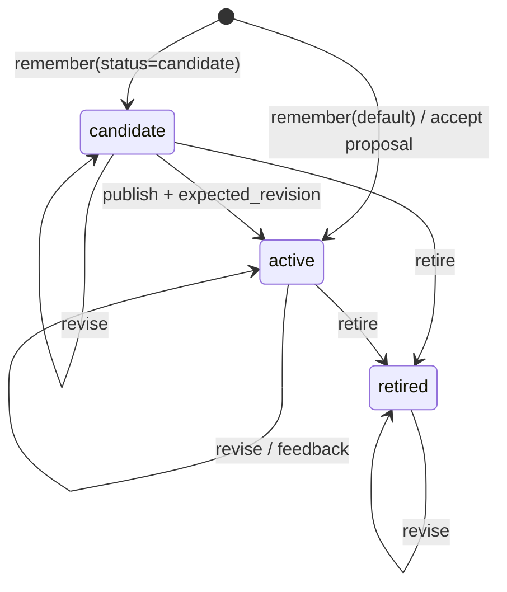
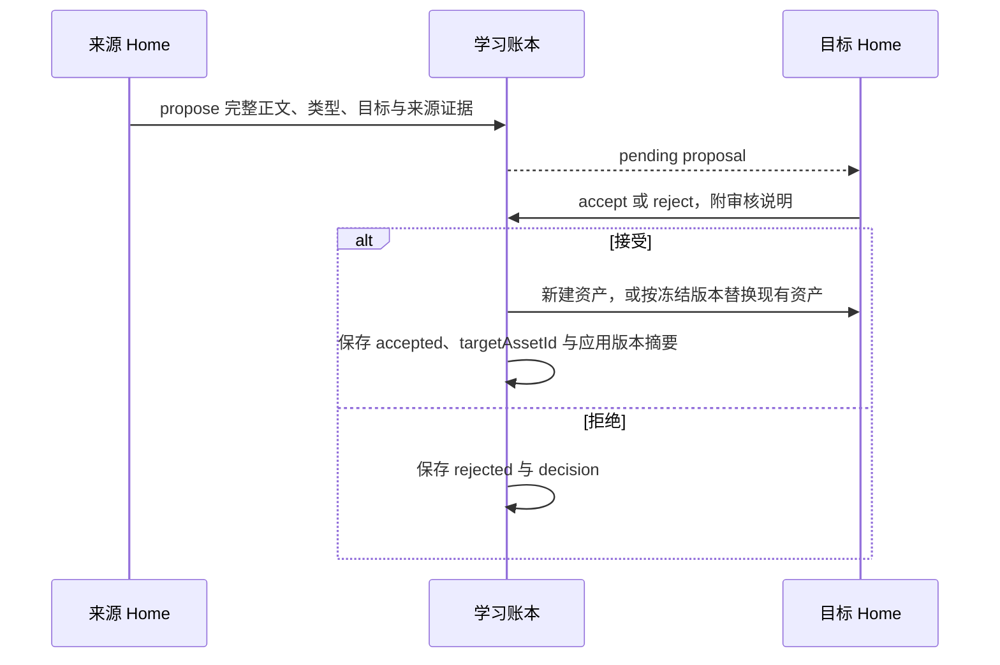

# 学习生命周期

本文回答三个问题：什么值得记住、什么时候生效、发现错误后如何退出。可执行演示见 [Learning Lab](../examples/README.md)。

## 内容类型与生效状态是两个维度

| kind | 保存什么 | 适合的描述 |
| --- | --- | --- |
| `memory` | 带具体语境的观察 | “本次活动更换渠道后，整体留存比较受流量结构影响” |
| `insight` | 有证据支持、仍需明确适用范围的推断 | “渠道结构变化可能解释部分总体差异” |
| `knowledge` | 可复用且有来源的事实或业务定义 | “演示业务按注册渠道定义获客 cohort” |
| `method` | 有前提、步骤和检查方式的做法 | “用相同渠道和观察窗口比较 cohort，再单列总体结果” |

`kind` 不代表已验证，`status` 才决定是否进入默认检索。Method 也可以是 candidate；Memory 也可以直接 active。
Identity 是长期身份配置，当前学习工具不允许自动修改。Episode 由 DSH Session 与 binding 表达，UI 的数量是
已知绑定 Session 数，不等于经过自动总结的工作报告数。

Agent 可以用 `bizagent_episodes` 找到本 Home 的既往 Session，再用 `bizagent_episode_read` 按页回读
原始事件。原始事件提供学习材料，仍需判断适用范围并用当前 turn 的证据保存候选；它们不会自动变为记忆。

`bizagent_learning_materials` 提供增量扫描：它分别比较既往 Session 的当前事件指纹、Agent 撰写或正式 Work 结果的最新 Worklog 修订与已有审阅回执，返回未审版本。由 Session 原事件生成的自动活动日志不重复入队。
扫描失败的来源仍显示为不可用。只有 `bizagent_learning_review` 的显式回执才把扫描时冻结的版本记为已处理；
普通成功工作也可以进入这条路径。新事件追加或 Worklog 出现新修订后，下一次扫描会返回新材料。
审阅可以得出“无需新记忆”的结论，回执摘要要交代原因；是否创建候选仍由实际工作与证据判断。

若要集中整理，在专门的 DSH Agent Session 调用 `bizagent_learning_batch_start`。它冻结当前 Home 最多
8 份未审材料，每个 Home 同时只允许一个 open 批次。Agent 用 `episode_read` 查原 Session，或用 `worklog_read` 指定冻结修订，逐条调用
`bizagent_learning_batch_settle`，可创建最多 3 条带原始连续事件证据的 candidate，或记录不新增的理由。
Worklog 候选引用确切修订，原 Session 暂不可读时仍可保留修订正文并标明来源状态。批次状态和每条回执持久化，可在同一 Session 恢复后继续；来源指纹变化时必须放弃并重扫。全部结算后由
原整理 Session `complete`；中断且无法恢复时，同 Home 的其他 Session 可写理由 `abandon`，未处理材料仍可
再扫描。已登记的整理 Session 不作为后续学习材料。直接调用批次工具时，当前 Agent 自己整理。

新批次会冻结当前 Home 受管理的 Identity 与四类长期资料文件。完成或放弃时再取原始字节，按 SHA-256 记录
`libraryChanges` 的 created / updated / deleted，并保留前后版本供 `bizagent_learning_batch_change_read` 分页回读。
无变化也是可核验结果。单文件上限 8 MiB、每批最多 1000 个文件和 64 MiB；结束时无法读取或超限会写入
`libraryChangeError`，不把该批次永远留在 open。差异可能包含同 Home 其他 Session 的并发写入，不能直接
归因为本次学习；任意 Workspace 文件和后续业务效果仍需要独立证据。

`bizagent_learning_launch` 可显式启动同 Home 的独立 DSH 学习 Session；该 Home 必须映射一个真实 Workspace。
它冻结确定的 worker Session ID、提示 ID 和请求方模型路由，启动失败后只恢复已持久可见的同一 Session。
缺失的预留 Session 与空闲但未完成的执行进入 `needs_review`，经核查且无 live worker、无 open 批次后才可
`bizagent_learning_launch_abandon`；不会悄悄再建 Session。空材料在 worker 的扫描步骤直接完成启动记录。
若进程中断时批次已打开，新宿主恢复原 Session 后会发送一次确定 ID 的继续审阅提示，先读取同一批次进度，
只处理尚未结算的材料；再次重启不会重复入队该提示。隔离 Headless profile 的故障演练在批次打开后终止
第一个测试进程，第二个 DSH 进程沿用原 worker Session 和批次完成，并核验候选仍指向原来源事件。
宿主可选启用 `learningSchedulerEnabled`，并用 `learningSchedules` 为已映射 Workspace 的 Home 配置上海时间
五字段 cron、执行模型和每日 1–4 次上限。定时器先复用增量扫描；前 100 个有界来源没有待审材料时，
记录 `empty` 并不创建模型 Session。每个到期周期保存游标，启动使用确定的周期键和同一预留机制；游标写入前
退出时可识别已预留 Session，恢复仍只针对已持久存在的 Session。超过 24 小时的旧周期直接过期；
有未解决的启动或 open 批次时，本周期记为 `deferred`，不叠加一个新运行。每日上限按上海日期计算，
包括已预留但结果不确定的运行。宿主必须只在该 profile 的一个进程上启用调度器。

宿主先以 `learningSchedules` 指定允许自动学习的 Home、固定模型和每日最高次数。已启用宿主定时器时，
本地 BizAgent 学习页面可对这些 Home 修改 cron、降低每日次数或关闭后续周期；设置带 revision，过期页面不能
覆盖新值。关闭不会中断已启动的 Session，重新启用后从下一次 cron 开始，设置与游标均写入学习账本。
Agent 工具不能自行开启自动学习。此 UI 沿用本地单用户、同源写入边界，尚无真人身份验证或逐人额度授权。
Home 是执行归属。`bizagent_learning_launch_read` 从该启动固定的 worker Session 持久事件回读模型上报的
token：同一步优先使用流式 usage 分片，缺失时才用 assistant message 的后备记录；缓存输入单列，
缺报步骤保留为 `unreportedSteps`。没有用量上报时不返回 `reported` 数值，不把缺失当零；
`costUsd=null`，因为 DSH 事件没有可信价格。当前仍没有费用账本、逐人额度承担人或额外的候选发布授权。
显式启动工具不受定时策略开关影响。

本地可用 `npm run smoke:learning -- --recover` 重演上述跨进程故障点；脚本只操作临时 DSH profile 和
自己创建的测试子进程。

当前没有自动执行 Memory → Insight → Knowledge → Method 的抽象流水线，也没有用于变更已有资产 kind 的
`memory_update` 参数。提案类型由创建者选择，审核者若需改类型应要求重新提案。

## 状态转换

数据模型还包含 `superseded`，可用于读取已有历史资产；当前工具没有自动替代或生成替代链的 action。
`revise` 保持原状态，包括 superseded 和 retired。`publish` 只接受 candidate，不能用它恢复退休资产。

## 同一 Home：先核验，再发布

1. 完成实际工作。若结论尚未核验，用 `memory_remember` 保存 candidate，写明前提、证据和待检查项。
2. 用 `memory_search(status="candidate")` 查候选，再用 `memory_read` 读取正文与 **asset revision**。
3. 用 `evidence_read` 回读来源；判断证据是否支持当前措辞和适用范围。
4. 用 `memory_update(action="revise", expected_revision=...)` 修订；候选仍是 candidate。
5. 重新读取并审阅最新版本，再用 `action="publish"` 与该 revision 发布。

若返回 revision conflict，重新读正文与证据，确认他人的修改，再决定是否发布。不要仅替换为新的数字自动重试。
`expected_revision` 是资产版本，不是 `home_status` 的 Home revision。

| 版本 | 含义 | 典型变化 |
| --- | --- | --- |
| Asset revision | 单条资产的内容/元数据版本 | revise、retire、publish、改变 fitness 的 feedback |
| Home revision | Identity 与 active 资产集合的上下文版本 | 发布候选、修改 active、退休 active |

新建或编辑 candidate 不改变 Home revision，也不进入默认索引。Asset revision 会照常变化；发布后才改变 Home
上下文。对 active 的 fitness 更新也会递增 Asset revision，从而更新 Home digest。

## 跨 Home：目标所有者裁决

Proposal 和 candidate 是两种不同记录：candidate 是本 Home 中尚未生效的资产，proposal 是交给另一 Home
审阅的消息。发送 proposal 不会在目标 Home 生成可检索资产，发送方也不能自行 accept。

新建提案由宿主验证有权的真人审阅正文、描述、类型和标签后接受或拒绝。要替换现有资产，来源 Home 必须先打开目标
Home Frame，并给 `bizagent_memory_propose` 传 `target_asset_id`。提案冻结目标资产 ID、revision 与正文
SHA-256；接受时只能保留原类型，目标版本或正文变化会拒绝覆盖，提案继续待审，须读取最新版重新提案。
审核卡片显示被替换资产的当前正文和版本，过期时关闭接受按钮；服务端仍复核摘要。审核人、授权引用、
动作、理由和时间在写资产前冻结于提案。应用记录与新正文同写在资产文件中，提案结算中断后按该标记
及已冻结的人审记录恢复，不重复改写。接受记录保存应用 revision 和正文摘要；
资产详情可查看各次提案的应用 ID、revision 与正文摘要前缀。
目标资产保留原来源并合并提案来源，不会自动建立对来源资产的实时同步关系。之后在目标 Home 退休或
编辑它，不会同步改变来源 Home 的副本。

相同人审决定重试可返回已有资产；已拒绝的提案不能再接受。Agent 可读自身收发的提案，无法浏览无关提案。
默认本地 UI 仅供查看提案；宿主须显式挂载认证裁决路由并提供逐提案权限回调，详见[架构](architecture.md)。
真实用户目录和权限策略仍需宿主接入。

## 证据支持追查，结论仍需审阅

主动 remember / propose 引用当前 DSH turn 的事件范围；更新保留旧引用并补充当前范围。明确纠正检查点引用
触发它的原始用户消息。工具自动生成这些引用，不要求模型猜测事件序号。

当前 `evidence_read` 读取 `session-events` 时先检查引用范围完整性，再最多返回 24 个事件；单个文本事件
最多返回 4000 个字符。`omittedEvents` 表示返回被截断。它也能按 Home 边界及 SHA-256 回读经
Claude 迁移包保留的业务 Markdown 与独立 Claude run worklog artifact 原文；后者不拥有 DSH Session 事件范围。
其他 document、artifact、asset 引用类型
不意味着此版本已经支持读取。

引用存在只证明“结论来自这里”，不证明结论正确。若来源 Session 已丢失，保留的 Markdown 正文不能替代原始
事件。应把无法核验的范围写清楚，不要把模型自行概括当成已经验证的业务规则。

## 自动检查点的触发范围

在 `agent/turn-stopping` 时，触发器只检查保守的明确纠正。若纠正之后已经有成功的学习工具结果，避免重复追加；
失败调用、未完成调用、较早的学习不会消除较新的纠正。普通 turn 不做自动复盘。

同一 Session/turn 最多产生一个 checkpoint。Agent 用插件提供的 ID 选择 remember 或 skip；skip 需要理由。
remember 写入 active Memory；工具结算后结束该 turn。若最终未结算，记录 failed。该机制不自动发布任意候选，
不生成 Insight，也不修改 Identity。

## 使用与反馈

| signal | 如何产生 | fitness 增量 |
| --- | --- | --- |
| `retrieved` | `memory_read` 自动记录 | 0 |
| `applied` | 在任务中使用后调用 feedback | 0 |
| `confirmed` | 后续结果支持资产 | +0.2 |
| `contradicted` | 后续证据与资产冲突 | −0.3 |
| `failed` | 使用后未达到预期 | −0.3 |

Fitness 限制在 −1 到 1 之间，是简单的使用信号，不是概率、真实性评分或模型置信度。累计至少两条 contradicted / failed
回执会返回 `reviewRequired: true`；这不是最近两次的滑动窗口，也不会自动退休资产。owner 仍需查证后 revise 或 retire。
这些回执不是外部效果评测，不应把更高 fitness 宣传成已经证明的业务提升。

读取与反馈回执冻结当时的资产 revision 和正文 SHA-256；相同回执 ID 不会覆盖初次记录，冲突重用会报错。
同一 feedback 调用 ID 重放不会再次改变 fitness；新的调用 ID 仍代表新回执，需由一次真实使用产生。

`bizagent_memory_use_outcomes` 只查询当前 Home 资产与该 Home 执行的已完成正式 Work。它核对 worker Session
绑定、原始工具调用和完成 turn，展示在交付前的 `retrieved` 或自报 `applied`、当时资产版本及冻结结果。
`verified` 表示这条持久来源链可回读；`changed` 或 `unavailable` 不应作为已核实使用。旧回执没有版本摘要，
只能标为未核实。即使来源均已核实，同 Session 的先后关系也不能证明资料促成了交付或业务收益。
DSH Web 学习台展开资产时可从当前 Session 的 Home 查看同一查询；不同 Home 的资产不在这条只读路由中返回。

## 一条有用的资产该写什么

建议 description 回答“什么时候该读我”，body 至少说明：适用范围、结论或步骤、已知例外、验证方式。把单次观察
写成候选，比把不确定经验写成普遍定律更容易维护。候选不会自动过期；定期按 candidate / retired 筛选清理审阅队列。
